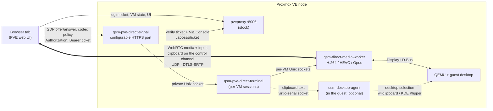

# QSM Direct

**A real desktop inside the Proxmox web console.** QSM Direct replaces the
rectangle-by-rectangle noVNC picture with a 60 fps WebRTC stream — encoded in
hardware where the node has NVENC, QSV or VA-API, on the CPU otherwise — in
the same browser tab, with the same PVE login and the same `VM.Console`
permission. Nothing to install on the client.

Project sponsor: [Takt](https://taktcycles.com/).

On a tablet, slide one finger to move the cursor and tap to click. Hold
for half a second before moving to select or drag; hold and lift without
moving for a right click. Two fingers scroll and a pinch zooms the view.
Bindings can be changed under Console settings / Touch gestures.
The [shared10 touch update](https://github.com/rdmitry0911/qsm-rd/releases/tag/v0.4.0-qsm-direct-20261015-shared10)
also updates the old saved one-finger selection default.

## Installation profiles

[Stock4.7 source, debs and instructions](https://github.com/rdmitry0911/qsm-rd/releases/tag/v0.4.0-qsm-direct-20261025-stock4.7)
preserve static reference detail when the working network target changes.
The worker budgets raw pictures before encoding, retaining encoder settings;
a narrow link reduces motion cadence. This extends the earlier isolated-loss
fix to genuine rate changes, for the common VM/LXC path. The per-guest maximum
remains configurable. Sudden large bandwidth drops can still cause freezes.
Standalone UI compatibility with existing shared-display VMs is retained.

Stock4.2 defaults to **Exact typing**: a key press or client repeat crosses
as one complete action, so network delay cannot stretch a short press into
native guest autorepeat. The first character is immediate. Modifier chords
work normally. **Physical holds** and **Raw input** remain available for games
and shortcuts which need a held ordinary key; Raw always forces physical
input. Physical holds use 50 ms state confirmations and a 200 ms release
watchdog, which bounds stale holds but cannot guarantee zero false native
repeats. Reload PVE with cache bypass and reopen consoles after upgrading.

Stock4.3 adds **Exact clicks** by default for mouse and trackpad taps/clicks.
A short click is sent on release as one action with position and modifiers.
Moving 4 pixels or holding for 250 ms starts a physical drag/hold; its motion
and release stay ordered, with the existing stale-hold watchdog. Touch taps
use the same atomic action; the existing hold-to-drag gesture is retained.
Fractional trackpad scroll deltas are accumulated, including horizontal scroll.
Choose Physical button holds or Raw for immediate down/up input. Ordinary
cursor motion still uses the fast pointer channel after action acknowledgement.

Stock4.4 adds **Capture keyboard (full screen)** in the toolbar and Settings,
including in the embedded console. Firefox/Safari use the Fullscreen API's
keyboard-lock option; Chromium retains its separate Keyboard Lock API.
No F11 or macOS shortcut remapping is required. Single Esc and available
browser shortcuts go to the guest. Click Release keyboard
or hold Esc to leave capture; Guest first also provides Ctrl+Alt+Shift+Esc.
OS-reserved keys still depend on the platform; Send to guest buttons remain
available. The earlier Firefox limitation was a missing QSM API path,
not a claim that current Firefox cannot capture browser shortcuts.

Stock4.5 preserves fullscreen when switching host applications or tabs.
QSM releases guest-held input and pauses delivery on blur/visibility loss;
on return it resumes capture inside the existing fullscreen, without
restoring old holds or requesting fullscreen again. Explicit Release
keyboard, Client first, close and long Esc remain exit paths.

Stock4.6 respects logical modifier remapping, including swapped macOS
Option/Command, while printable keys retain guest-layout physical positions.
Logical Command+Tab stays on macOS; logical Option+Tab sends guest Alt+Tab.
Command is deferred until a guest action so host switching does not emit a
stray guest Alt/Super or launcher tap. Mouse chords and physical main-key
holds flush/use the modifier as needed; an intentional solo Command tap
still sends Super. **Raw** keeps physical positions and bypasses host routing.
Use **Guest first**, not Raw, to follow the macOS modifier swap.

Stock4.7 keeps fullscreen while opening/editing Settings and resumes guest
capture on Close. **Capture keyboard** is now a text button near the top of
the toolbar and the first Settings action, with Close beside the panel title.
The reveal handle stays beside the visible toolbar, avoiding blocked controls.

Install and update the standalone packages through the signed
[APT repository](https://rdmitry0911.github.io/qsm-rd/): follow the
[scoped key and repository setup](packaging/apt/README.md), then install
`qsm-pve-direct-standalone`. The repository targets PVE 9 / Debian 13 amd64;
it contains no patched PVE packages. Direct release-deb installation remains
available. See the [Debian archive assessment](upstream/debian-distribution-2026-10-20.md)
for the separate path to official Debian packaging.

| Profile | Proxmox packages | Browser-to-node connectivity |
| --- | --- | --- |
| [Standalone, direct UDP](packaging/debian/README.standalone) | Official PVE 9 | HTTPS 8006, configurable QSM HTTPS port (initially 18007 or next free), WebRTC UDP |
| [Standalone with gateway](packaging/debian/README.gateway) | Official PVE 9 | One TCP port: 8006 on the node, including a router/NAT forward |
| Native shared platform | Matching patched preview packages | HTTPS 8006 and direct WebRTC UDP |

In gateway mode HTTPS protects the UI, authentication and signalling; SRTP
protects audio/video and DTLS protects input/clipboard. TURN control messages
use plain TCP, without an outer TLS layer. It is not an HTTPS-only or
TURN/TLS transport. The gateway is explicitly enabled for single-node
deployments; read its proxy/SPICE impact and rollback instructions first.

## Native shared platform

The current upstream proposal uses Alexandre Derumier's per-VM D-Bus
foundation. qemu-server owns the bus; QSM attaches as a display consumer.
Native signalling and codec settings use the existing PVE API on port 8006.
CPU displays keep noVNC available; GL displays use the D-Bus console.

[Shared9 preview packages](https://github.com/rdmitry0911/qsm-rd/releases/tag/v0.4.0-qsm-direct-20261015-shared9)
include the matching Proxmox packages, installation notes and checksums.
LXC uses the same authenticated API for availability, offers and settings.
Native VM and LXC consoles need no separate HTTPS port or certificate
exception; WebRTC media still needs UDP connectivity to the node.

Apply the [shared-base and native UI series](upstream/README.md), install
qsm-pve-direct, then stop and convert an existing managed VM:

```sh
qsm-pve-direct-migrate <vmid>          # preview
qsm-pve-direct-migrate <vmid> --apply  # private backup, then update
qm start <vmid>
```

For a new VM, enable `dbus-display: 1`, select `vga: std` or
`vga: virtio-gl,rendernode=/dev/dri/renderD128`, and optionally select
`audio0: device=ich9-intel-hda,driver=dbus`. See the
[validated package and migration instructions](packaging/debian/README.qsm-pve-direct).
The upstream patches are proposals; stock PVE still uses the add-on mode
below. LXC guest desktop/session setup remains in its separate package.

## Standalone architecture (stock PVE)

For stock PVE 9, the optional `qsm-pve-direct-standalone` installation profile
enables the independent signalling service without replacing Proxmox packages.
It chooses a free port starting at 18007 and supports a configured bind IP,
port and advertised HTTPS origin. The optional
[`qsm-pve-direct-gateway` profile](packaging/debian/README.gateway) shares TCP
8006 between HTTPS signalling and authenticated TURN/TCP media for firewalls
that admit only 8006 plus established traffic. It is explicitly enabled on
single-node stock PVE and changes the proxy listener, with a reversible setup.
For a router/NAT setup, forward public TCP 8006 to the node's TCP 8006 and
use the node's LAN IPv4 as `--relay-ip`; no public UDP mapping is needed.
The browser uses the actual public hostname and port of its PVE page.
See [standalone installation and address settings](packaging/debian/README.standalone). Existing installations without
an endpoint configuration retain their previous port 8007.



The diagram shows the direct-UDP profile. The browser reaches the node on
two TLS ports: stock pveproxy on 8006 for login, VM state and the UI, and
the configured QSM signalling port (initially 18007 for standalone; 8007
for legacy installations without endpoint configuration) for the
one SDP exchange and the codec policy. The signalling service authorises
every call by asking pveproxy's own `/access/ticket` to confirm the browser's
ticket and `VM.Console`; the audio, video and input then flow directly as
WebRTC between the browser and the node's media worker.

## Why it feels like a local desktop

Open the **Console** of a VM and:

- **Video plays as video.** A 30 fps 720p clip reaches the browser as about 27
  distinct pictures per second in the CPU lab, 28 on the RTX 3080 node. Stock
  noVNC on the same guest shows about 7 pictures per second and needs six times
  the bandwidth to do it.
- **Scrolling and animation stay smooth.** Every guest frame is encoded at a
  constant cadence. In the same lab, with the same guest image, a scrolling
  document reaches the browser as 36 pictures per second with a 39 ms p95 gap
  between pictures under VirGL + QSM Direct; noVNC on that node manages 12
  pictures per second with a 134 ms gap. On a node with an RTX 3080 the same
  document reaches 52 pictures per second with a 34 ms gap.
- **Mouse motion cannot queue up.** Pointer positions travel on their own
  unordered, latest-state lane, so a lost or late packet is replaced by the
  next position instead of delaying a click or piling up behind a busy frame.
- **It uses the hardware you have.** NVENC, QSV, VA-API or `libx264`; H.264
  by default, HEVC as an explicit experimental per-VM choice; VirGL/GL guests
  or plain VGA guests.
- **Same login, same ACL.** Existing PVE credentials and `VM.Console`
  permission. Native and gateway profiles use the PVE HTTPS origin;
  standalone direct UDP uses its configured signalling endpoint. No pairing
  PIN, native client or host X11 session.
- **A sleeping guest is explained, not hidden.** When the guest blanks its
  screen or locks, the console says so and any mouse or key press wakes it.
- **Sound, microphone and clipboard.** Guest audio plays in the console
  (Opus), the browser's microphone reaches the guest, and text copies both
  ways between the browser and the guest desktop.
- **Containers too.** An LXC container with a KDE Plasma desktop gets the same
  console, with its own login screen per console (see
  [LXC containers](#lxc-containers)).

## QSM Direct against stock noVNC, measured

Four ways to look at a PVE 9 virtual machine, measured on 2026-09-07 (motion
and bandwidth) and 2026-09-08 (interaction) with one guest image, one browser
host and the same workloads in a CPU-only nested lab (`libx264` on the node,
4-vCPU guests with software rendering — the guest itself caps the frame rate in
every column). "Pictures/s" counts *visibly
different* pictures reaching the browser each second; the gap is the p95 pause
between two of them. Method, environments, raw numbers and reproduction
commands: [docs/COMPARISON.md](docs/COMPARISON.md).

**Motion — pictures/s, p95 gap**

| Workload in the VM | VirGL + QSM Direct | Standard VGA + QSM Direct | Standard VGA + stock noVNC | VirGL + stock noVNC³ |
| --- | ---: | ---: | ---: | ---: |
| 720p clip, 30 fps source | source rate¹, 39 ms | 26.6, 67 ms | 7.4, 175 ms | 6.9, 197 ms |
| Scrolling a long document | 36.2, 39 ms | 14.4, 118 ms | 12.0, 134 ms | 21.6, 74 ms |
| Animated UI, dashboards | 38.5, 34 ms | 16.2, 115 ms | 11.0, 152 ms | 11.6, 116 ms |

**Cost and capabilities**

| | VirGL + QSM Direct | Standard VGA + QSM Direct | Standard VGA + stock noVNC | VirGL + stock noVNC³ |
| --- | ---: | ---: | ---: | ---: |
| Bandwidth, 720p clip | 18.8 Mbit/s | 19.6 Mbit/s | 120 Mbit/s | 113 Mbit/s |
| Bandwidth, animated UI | 12.8 Mbit/s | 9.0 Mbit/s | 31.6 Mbit/s | 29.1 Mbit/s |
| Bandwidth, idle desktop | 0.55 Mbit/s | 0.55 Mbit/s | ≈ 0 | ≈ 0 |
| Pointer onto an icon → hover popup⁴ | 88 ms | 88 ms | 52 ms | 34 ms |
| Console opens to first picture | 3.4 s | 3.4 s | 1.0 s | ~1 s |
| Guest resolution follows the window | yes | no (fixed mode, scaled) | no | yes |
| Guest OpenGL / 3D applications | yes | no | no | no (VNC is 2D) |
| Node CPU per open console (`libx264`) | ≈ ½ core² | ≈ ½ core² | none | none |
| Needed on the node | a DRM render device (`/dev/dri/renderD*`) + any encoder | any encoder | nothing | nothing |

¹ The VirGL guest presents above the clip's 30 fps source; read it as the full
source rate. Method and raw counts: [docs/COMPARISON.md](docs/COMPARISON.md).
² Lifetime average of the worker process during the animated scene on the
nested node; NVENC on the RTX 3080 node used 13 % of the GPU and 4 % of its
encoder during the same workload.
³ QSM Direct and stock noVNC are alternatives on the same VM, not
simultaneous: the QSM Display1 profile sets the PVE graphics card to *none*,
so while it is active noVNC is black. This column is the VirtIO-GPU guest with
QSM Display1 **off** and viewed through noVNC — a smoother guest than Standard
VGA, so its noVNC scroll (21.6) beats Standard VGA's (12.0), but it still
sends whole changed rectangles at video (113 Mbit/s) where QSM Direct sends an
encoded 18.8 Mbit/s stream.
⁴ Pointer moved onto the fixture's icon until its hover popup paints, timed
from the browser's own mouse-event with `lab/proxmox9/measure-interaction.cjs`
— the same tool and clock for every column, median of five runs. This is a
single isolated event: noVNC pushes one small rectangle, while QSM Direct pays
a fixed encode-decode-jitter cost that on this CPU-only lab is a full software
encode. It is the opposite of the sustained-motion rows above, which QSM Direct
wins profile-for-profile. This event cost was measured only on the CPU-only
lab; it was not re-measured on the RTX 3080 node.

The same VirGL + QSM Direct workloads on a real node with an **RTX 3080**
(NVENC H.264, an Ubuntu 26.04 KDE guest) reached 28 pictures/s for the 30 fps
clip with 0 dropped frames, **52 pictures/s** for the scrolling document and
**45 pictures/s** for the animated scene, with 34–67 ms p95 gaps.

Where noVNC is still the better tool: the first picture after opening the
Console (it needs no codec negotiation), the latency of a single isolated
pointer event (the hover row above — one small rectangle beats an encode-decode
round trip), zero bandwidth on an idle screen, and anything before an OS is
running — firmware, installers, recovery, text consoles — on a VM that still
has a VNC server (the Standard VGA profile, not VirGL). QSM Direct is for the
hours you spend *inside* a running desktop, where the motion above is what you
feel.

## Requirements

- **Proxmox VE 9** (`pve-manager` 9.x). Nothing is loaded into pveproxy or
  pvedaemon; the only PVE contract used is the documented `/access/ticket`
  authorisation endpoint. The one script tag added to the PVE web page is
  allow-listed per `pve-manager` version and template checksum: after a
  `pve-manager` upgrade the package knows nothing about, the stock page is
  restored and VMs show the ordinary noVNC console until a package update
  adds that version (`qsm-pve-direct-ui status` tells which state is active).
- **Browser:** any browser whose WebRTC offers H.264 and Opus — Chrome, Edge,
  Chromium with proprietary codecs, Safari; Firefox with its OpenH264 plugin
  enabled. A browser without H.264 is refused (the reason is logged in the
  node journal). In direct-UDP standalone mode the console fetches the
  signalling port cross-origin; reach PVE by a host name the node certificate is valid for
  (or install a trusted certificate); a certificate the browser only accepts
  after a click-through works for the main page but blocks the signalling
  fetch. The gateway serves signalling on the PVE origin and uses the same
  node certificate, so no separate signalling-port exception is needed.
- **Network:** standalone direct UDP requires TCP 8006, the configured QSM
  HTTPS port and negotiated WebRTC UDP ports. The optional single-node
  gateway carries HTTPS/signalling and TURN/TCP on the node's TCP 8006;
  relay-to-bridge UDP remains local. It also works behind a router with
  only TCP 8006 forwarded. A proxy permitting only HTTPS cannot carry the
  gateway's plain TURN/TCP connection. Native-preview media still needs UDP.
- **Encoder:** NVENC, QSV or VA-API with the vendor driver, or the CPU
  (`libx264`, about half a core per open 1280×800 console). HEVC needs a
  hardware encoder.
- **Clusters:** install the package on every node that may run the VM. The
  Display1 profile references a node-local socket, so a VM with QSM Display1
  enabled starts only where the terminal service is running. Live migration of
  such a VM has not been qualified.
- **Capacity:** up to 16 concurrent console sessions per node; the terminal
  service and all its encoder workers run under a 1 GiB `MemoryMax`, which a
  systemd drop-in can raise.

## Standalone installation (stock PVE)

Use the matching release debs and follow
[README.standalone](packaging/debian/README.standalone). For a single
forwarded TCP port, also follow [README.gateway](packaging/debian/README.gateway).
Never install the container-only `qsm-console-guest` deb on the PVE host.

Build the PVE 9 package on Debian 13 with
`packaging/debian/build-qsm-pve-direct-deb.sh` (or in a throwaway chroot with
`scripts/build-qsm-pve-direct-in-trixie.sh`; needs cmake, ninja, the FFmpeg
development libraries and libopus). Build the matching standalone profile
with `packaging/debian/build-qsm-pve-direct-standalone-deb.sh`, setting the
same `QSM_DIRECT_DEB_VERSION` for both builders. Install on the PVE node:

```bash
apt install ./qsm-pve-direct_0.4.0+stock3_amd64.deb \
            ./qsm-pve-direct-standalone_0.4.0+stock3_all.deb
qsm-pve-direct-endpoint --show
qsm-pve-direct-ui status
```

What it changes on the node: two new systemd services —
`qsm-pve-direct-terminal` (Unix sockets only, no listening port) and
`qsm-pve-direct-signal` (one configured HTTPS port, using the node certificate); a
patched `index.html.tpl` that adds one script tag (the stock template is
restored on removal and on an unknown `pve-manager` version); and a per-VM
policy directory `/etc/qsm-pve-direct/instances.d`. It does **not** modify
`pveproxy`, `pvedaemon` or any PVE Perl file. Removing the package restores
the template and stops both services. The optional gateway additionally
changes the proxy listener; its `disable` command restores the prior config.

Log in as `root@pam` (enabling QSM Display1 edits the VM's `args:` line,
which Proxmox reserves for root), open **Hardware → Display → Advanced** of a
VM, enable **QSM Display1** and pick a profile:

- **VirGL GPU (GL)** adds a private `virtio-vga-gl` and a GL D-Bus Display1 —
  the smooth column above, with guest 3D. It sets the PVE graphics card to
  *none*: the VM has no VNC server while this profile is active, so stock
  noVNC (including firmware and installer output) is available again only
  after switching back to the CPU profile and restarting the VM.
- **CPU — Standard VGA, VirtIO or VMware (no GL)** keeps the selected adapter
  and adds a non-GL D-Bus Display1 — no GPU or render device required; stock
  VNC keeps working next to it. Pick **VirtIO** if you want the guest
  resolution to follow the console window; Standard VGA and VMware keep their
  own mode and are scaled.

**Sound** is PVE's own **Hardware → Add → Audio Device**: on a VM with QSM
Display1 it offers the backend **QSM Console** (and preselects it), an Intel
HDA sound card with speakers and a microphone input whose output plays in the
console and whose input takes the browser's microphone. PVE's stock backends
(SPICE, none) cannot feed the console, so this one lives in the VM's `args`;
the Hardware list shows it as the VM's Audio Device, and Edit and Remove work
on it as usual. Like the Display setting it edits `args`, so it needs
`root@pam`.

**Save, then stop and start the VM** — a reboot from inside the guest is not
enough, QEMU must be relaunched with the new display. Then use the existing
**Console** entry in the left navigation, between **Summary** and
**Hardware**: an eligible VM gets QSM Direct embedded right there, an
ineligible VM keeps the ordinary noVNC console, and the top **Console** split
menu opens QSM Direct in a separate window. Opening the console needs
`VM.Console`; saving the per-VM codec policy needs `VM.Config.Options`.

Full screen is the same console at the full viewport. Bidirectional clipboard
comes with `qsm-desktop-agent` in a Linux guest running a Wayland desktop
(KDE Plasma Wayland, or another compositor with `wl-clipboard` installed):
`qsm-desktop-agent-setup USER`. How it works is described under
[Clipboard](#clipboard) below.

Details: [installation](docs/INSTALLATION.md), [testing](docs/TESTING.md),
[measured comparison](docs/COMPARISON.md), [PVE 9 laboratory](lab/proxmox9/README.md).

## How it works

The browser sends its WebRTC offer to the node-local signalling service
(`qsm-pve-direct-signal`, configurable HTTPS endpoint, or `/qsm-direct/`
on the PVE origin with the gateway). PVE has no supported way to add an API
route, so the service does not touch pveproxy or pvedaemon: it authorises the
request by relaying the browser's ticket to the node's own `/access/ticket`
with `path=/vms/<vmid>` and the required privilege, and only the username PVE
confirms is used. The ticket travels in an `Authorization: Bearer` header, not
an ambient cookie, so the endpoint is CSRF-safe. On success the service hands
the offer to the terminal over a private Unix socket; the terminal starts one
media worker per VM. The worker reads QEMU's Display1 (GL scanouts through
DMA-BUF, or plain framebuffers), encodes H.264 or HEVC, and hands the
elementary stream to the WebRTC bridge, which only packetizes — nothing is
decoded or re-encoded on the way. Input goes back through Display1: keys and
clicks on an ordered channel, pointer motion on the unordered latest-state
lane. A session lives as long as its WebRTC peer is connected and is reclaimed
ten minutes after a browser vanishes.

All viewers of one VM share one encoder stream. The first Console picks the
codec; a later browser that cannot decode it is refused rather than handed
mislabelled video (the reason is logged in the node journal).

**Audio:** with an Audio Device on the backend **QSM Console** the VM gets an
Intel HDA sound card on a QEMU D-Bus audio backend (48 kHz stereo); the worker
receives its PCM through Display1, encodes Opus and sends it on the same
WebRTC connection. Browsers start the console muted (autoplay policy): the
speaker button in the toolbar turns the sound on.

**Microphone:** the console's audio is negotiated in both directions; the
microphone button asks the browser for the microphone (with its echo
cancellation and noise suppression) and only then sends it. The bridge decodes
it to 48 kHz PCM, and the worker serves it to QEMU's record stream (the sound
card's microphone input) from a small buffer. With several viewers, the one
who spoke last has the microphone. Browsers allow the microphone only on
HTTPS.

A VM needs that Audio Device (an older output-only QSM sound card is upgraded
when the Display or Audio Device is saved), then a stop and start.

### Clipboard

Copy and paste between the browser and the guest desktop travel on the same
WebRTC connection as the video, over its ordered control channel — never a
network service. The Console toolbar carries two buttons: **⧉** copies the
guest's current selection into the browser clipboard, and **⇩** pastes the
browser clipboard into the guest. Browsers only grant clipboard access from a
real user gesture, so each transfer is a button press, not silent background
sync.

Inside the guest, the optional `qsm-desktop-agent` owns a private QEMU
virtio-serial port (`org.qsm.direct.agent`) — no network, no listening port. It
keeps a small per-user clipboard state file that a per-user bridge mirrors both
ways against the real desktop selection: KDE Plasma through Klipper's D-Bus
API, other Wayland compositors through `wl-clipboard`. The terminal's per-VM
guest channel reads and writes that port over the per-VM Unix socket QEMU
already exposes, and the WebRTC bridge relays it to the browser as bounded,
base64-encoded `text/plain` UTF-8 (up to 1 MiB). Only text is carried; file
transfer is deliberately not part of the browser transport. Without the agent
the console still works — clipboard is simply unavailable.

Install it with `qsm-desktop-agent-setup USER` in a Linux guest running a
Wayland desktop.

In an LXC container no agent needs installing: the container package runs a
small clipboard agent in every desktop session (KDE Plasma, through Klipper)
and the terminal service reaches it through the container's root.

## LXC containers

A container has no QEMU display, so QSM Direct brings one: a headless sway
compositor per console inside the container, with its own login screen; the
host media worker captures it (wlr-screencopy), injects input and encodes with
the host GPU. Like the ttys of PVE's terminal console, the container has one
console per tty, each belongs to the PVE user who opened it, and a desktop
left logged in waits a grace period (default 5 minutes) for the same PVE user.

```bash
apt install ./qsm-pve-direct-lxc_*.deb      # on the node, next to qsm-pve-direct
qsm-pve-direct-lxc enable <vmid>            # a Debian/Ubuntu CT with KDE Plasma
pct exec <vmid> -- passwd qsm               # the desktop user it creates
```

`enable` passes the GPU through, installs the matching NVIDIA userspace and
the container package `qsm-console-guest`. The container's **Console** button
then offers **QSM Direct**. Video, input, resizing, clipboard, sound and
microphone work as for a VM: the session agent gives each desktop session a
"QSM Console" sound card and a "QSM Microphone" (PipeWire, through
pipewire-pulse) and relays both. Details:
[packaging/debian/README.qsm-pve-direct](packaging/debian/README.qsm-pve-direct).

For local cursor rendering on Ubuntu 24.04, optionally install the private
Sway 1.11 package with `qsm-pve-direct-lxc enable <vmid> --sway-deb FILE`
(add `--no-gpu --no-admin` when preserving an existing GPU/user profile).
Running desktops are preserved during installation: apply the compositor
change after logout by restarting the displays/login manager. The host
worker then captures cursor-free video and sends the real cursor shape,
hotspot and visibility separately; a desktop browser moves its native cursor
locally. Older compositors retain cursor-in-video capture. Build instructions
and activation details: [README.native-sway](packaging/lxc/README.native-sway).

## Native Proxmox integration (proposed)

[`upstream/`](upstream/) holds patch series for qemu-server and pve-manager
that would make this console part of Proxmox VE itself: a `dbus` option for
the VM display (QEMU's peer-to-peer D-Bus display, attached per connection
through QMP), a `webrtcproxy` API call next to `vncproxy`, and a WebRTC entry
in the console menu. The media service is then this package, reached through
`/run/webrtc-console/offer.sock`. On that path the clipboard is QEMU's own
(`qemu-vdagent` with `spice-vdagent` in the guest, which on a Wayland desktop
reaches X11 applications only), and there is no audio yet: in QEMU 11.0 a
peer-to-peer D-Bus display delivered no audio to its listener in our tests.

### Codecs

The VM media policy defaults to **Automatic (H.264)**: NVENC, QSV or VA-API
when one initializes, `libx264` otherwise. HEVC is an explicit, experimental
per-VM policy: the terminal then requires `video/H265` in the browser's SDP
offer *and* a bounded probe that initialized `hevc_nvenc`, `hevc_qsv` or
`hevc_vaapi` on the node, and packetizes the stream per
[RFC 7798](https://www.rfc-editor.org/rfc/rfc7798.html). It is never selected
automatically. HEVC lowers bitrate, not input latency: encoder look-ahead,
keyframe cadence, browser decode and jitter buffering still decide the
interaction delay.

### Adaptive video bitrate

The behavior below is included in stock4.1, using the tested stock4 video code. See its
[validation](upstream/review-video-budget-2026-10-23/qualification.txt).

In Console **Settings → This guest — media policy**, **Maximum video bitrate
(Mbit/s)** sets the per-VM/LXC encoder target ceiling (0.5–100, default 8).
H.264 with NVENC, libx264, QSV or VA-API, and experimental hardware HEVC,
automatically adjust the working target below that ceiling using the browser's
RTCP REMB, packet-loss and RTT feedback. Video/RTX pacing follows the target.
The worker keeps the encoder's configured quality budget and admits fewer
raw pictures when the current network allowance is insufficient. Every
encoded picture, including an IDR, is charged before another is admitted.
This preserves static reference detail and avoids rate-control resets on
NVENC or codec reopenings on Intel. Motion becomes less smooth on a narrow
link; an inexpensive idle picture can still retain the negotiated cadence.
Explicit media timestamps preserve timing when frames are skipped.
The WebRTC connection and guest session remain open. Several viewers of one producer share the rate,
so fresh feedback from a slower viewer can reduce motion cadence for all of them.
Closed viewers release that constraint. No guest restart is needed.

Adaptation ignores ordinary RTT jitter and app-limited REMB estimates. Packet
loss can lower the target promptly; delay alone must be substantial and
persist across new receiver reports for at least three seconds while video
is using the allowance. A congestion report is consumed once. Recovery waits
for ten healthy seconds and raises the target by a material step no more than
once every ten seconds, only when actual video traffic uses at least 70% of
the current allowance. Fresh REMB also bounds recovery, so a cleared queue
does not cause repeated ramps above a link that has settled at a lower rate.
An idle desktop does not need repeated upward probes.

All supported in-process encoders use on-demand recovery keyframes, rather than a
full IDR every half second. Under a one-frame VBV, those periodic refreshes
made static text blur and sharpen even with an unchanged bitrate. New
viewers, PLI feedback and a broken local reference chain still request IDRs;
an unanswered local request is retried at most once a second until recovery.
Network target changes do not request a full refresh. New viewers, real
packet loss and display resizes can still require a recovery picture.

Settings shows the current target and ceiling for the active producer. Save a
new ceiling, close all its viewers and reopen the console to apply that policy.
The `webrtcsettings` API still stores `bitrate` in kbit/s and requires
`VM.Config.Options` to change it; the on-node key is
`QSM_DIRECT_BITRATE_KBPS`. Existing clients and policy files remain compatible.
QSV and VA-API use the same shared VM/LXC controller and adaptive status.
Intel Iris Xe H.264/HEVC QSV and VA-API pass rate-change, recovery-IDR
and static-text decoder checks inside a Proxmox VE test VM with the GPU
passed through. AMD H.264/HEVC VA-API were also tested.
HEVC VA-API omits redundant AUD NALs: Intel's driver otherwise escapes their
Annex B start codes incorrectly. HEVC QSV uses bounded low-delay VBR, a
two-frame VBV and a frame-size limit to avoid an Intel CBR output-buffer
failure on static pictures. Hardware HEVC remains an experimental browser
option. A [native browser follow-up](upstream/review-hevc-browser-2026-10-19/qualification.txt)
also verifies HEVC QSV and VA-API in Chrome 147 on Linux with Intel Vulkan,
including congestion recovery without reconnecting. Firefox 155 in that
test offers H.264 rather than HEVC over WebRTC; automatic policy chooses
H.264 for it. Browser support and a working hardware decoder are required.
An [HEVC NVENC browser check](upstream/review-nvenc-hevc-browser-2026-10-19/qualification.txt)
also passes decoding, congestion recovery and requested-keyframe checks on
RTX 3080. Fixed-rate static text is stable; rare loss-triggered adaptive
reductions can still produce visible text-quality transitions in that test.

This ceiling describes the encoder's target, not total network traffic.
Audio, RTP/SRTP overhead, retransmissions and hardware rate-control overshoot
need additional bandwidth. At very low targets NVENC can exceed the requested
video rate: the tested high-motion 1280×800/60 fixture produced about 1.31 Mbps
at a 0.5-Mbps target. Pacing allows bounded additional low-rate hardware headroom
so that this does not continually break the local predictive-frame queue.
QSV and VA-API hardware can also overshoot low targets on difficult content.
For links below the encoder's practical minimum, lower the console resolution
or FPS or select software encoding. This release adapts bitrate, not resolution
or FPS. Abrupt bandwidth drops can still cause a short recovery interruption.
See [initial bitrate qualification](upstream/review-adaptive-bitrate-2026-10-17/qualification.txt) and
[controller stability checks](upstream/review-adaptive-stability-2026-10-17/qualification.txt) and
[full-resolution keyframe checks](upstream/review-keyframe-stability-2026-10-17/qualification.txt) and
[QSV/VA-API qualification](upstream/review-qsv-vaapi-2026-10-18/qualification.txt) and
[Intel hardware checks](upstream/review-intel-qsv-2026-10-19/qualification.txt).

### Sleeping and locked guests

A desktop guest blanks its output after an idle timeout or locks its session,
and then ignores a requested display mode until it wakes. After about four
seconds of an all-black picture the console shows *Guest display looks asleep.
Move the mouse or press a key here to wake it.*; a guest that keeps its own
size says *Guest display kept its own size. If the guest is asleep or locked,
move the mouse or press a key here.* Every mouse or key event re-issues the
pending window size once, and the status returns to *Connected* within about a
second of the guest painting or adopting the size. Measured on a KDE Plasma
guest with `lab/proxmox9/probe-display-sleep-recovery.cjs` (250 ms sampling):
the desktop is back within the first sample after the wake input, and never
without one.

## License

GPL-3.0-or-later (see [LICENSE](LICENSE)), except files whose SPDX header
says AGPL-3.0-or-later: the PVE console script
(`integration/proxmox/pve9/direct_ui/qsm-direct-console.js`), the signalling
service, the LXC console (`packaging/lxc`, `qsm-pve-direct-lxc`) and the
viewer page.

The shared viewer also releases held keys on in-page focus changes and ignores browser autorepeat from a press begun outside the guest. Reload/reopen consoles after upgrading to clear old input state and load the new viewer.
